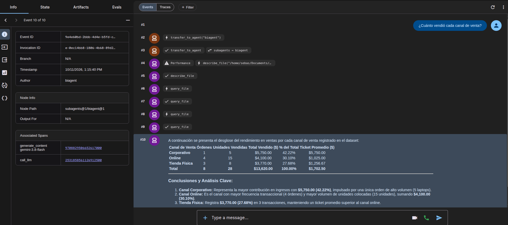
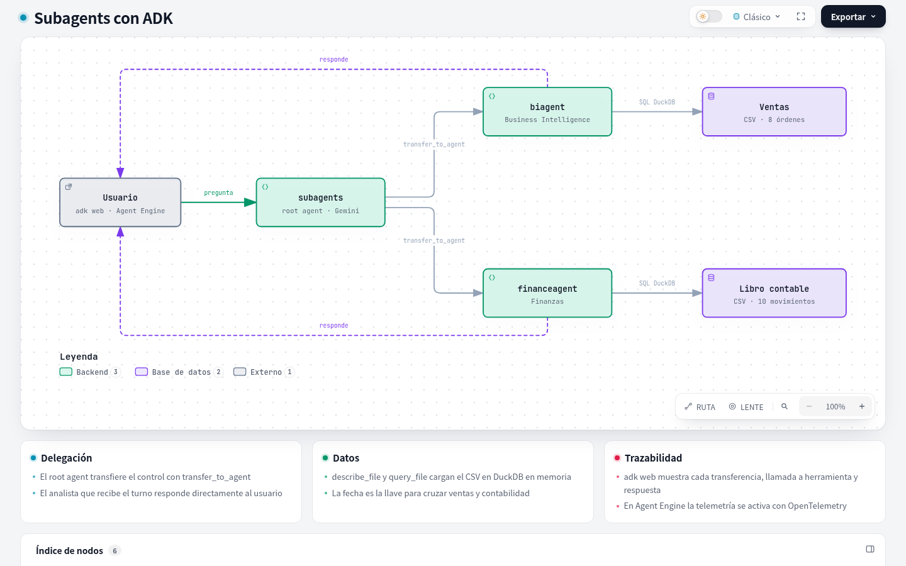

<div align="center">

# Subagents ADK

**Hazle preguntas a tus ventas y a tus finanzas.**

Un root agent de ADK que transfiere cada pregunta al analista correcto.


</div>

---

```text
Tú:        ¿Cuánto vendió cada canal de venta?
biagent:   Corporativo 5.750 (42,2 %), Online 4.100 (30,1 %) y Tienda Física 3.770 (27,7 %).
           Total: 13.620 en 8 órdenes.
```

El root agent decide si la pregunta es de ventas o de finanzas y **transfiere el control** al analista correcto. Ese analista consulta su archivo con SQL y responde directamente. Cada paso queda visible en `adk web`.



## Inicio rápido

```bash
uv venv .venv && source .venv/bin/activate
uv pip install -r requirements.txt

cp team/.env.example team/.env   # completa con tu proyecto

gcloud auth application-default login
adk web
```

Se abre la interfaz de **ADK** en el navegador. Elige el agente `team` y empieza a chatear.

> `team/.env` no se versiona: cada persona debe crear el suyo a partir de [`team/.env.example`](team/.env.example).

```bash
# team/.env
GOOGLE_GENAI_USE_ENTERPRISE=true
GOOGLE_CLOUD_PROJECT=<tu-proyecto>
GOOGLE_CLOUD_LOCATION=us-central1
```

## Cómo funciona



| Agente / herramienta | Qué hace |
|---|---|
| `subagents` | Root agent. Lee la pregunta y llama a `transfer_to_agent` con el analista adecuado. |
| `biagent` | Analista de ventas: canales, regiones, clientes, categorías y tickets. |
| `financeagent` | Analista financiero: ingresos, COGS, OPEX, nómina y márgenes. |
| `describe_file` | Muestra las columnas y filas de ejemplo de un archivo de datos. |
| `query_file` | Ejecuta SQL de DuckDB sobre el archivo, en memoria y sin acceso externo. |

[Ver el diagrama interactivo →](docs/arquitectura.html)

> **Transferencia frente a herramienta.** Con `sub_agents`, el root agent cede el turno y el analista responde al usuario sin volver a pasar por el manager. Por eso las preguntas que cruzan ventas y finanzas dependen de que un analista transfiera al otro. Si quieres que el manager consulte a los dos y sintetice, envuelve cada analista en un [`AgentTool`](https://adk.dev/tools-custom/function-tools/#agent-tool): seguirá siendo un subagente, pero devolverá su respuesta al manager.

## Preguntas sugeridas

<details>
<summary><b>Ventas</b> · <code>biagent</code></summary>

| Pregunta | Respuesta esperada |
|---|---|
| ¿Cuánto vendió cada canal de venta? | Corporativo 5.750, Online 4.100 y Tienda Física 3.770. |
| ¿Qué región tuvo más ventas? | Este, con 6.350. Le siguen Norte con 4.020 y Sur con 3.250. |
| ¿Qué cliente compró más de una vez y cuánto gastó en total? | C-501, con 2 órdenes y 3.650 en total. |
| ¿Cuántas unidades se vendieron por categoría de producto? | Accesorios 14, Laptops 8, Smartphones 4 y Monitores 2. |
| ¿Cuál es el ticket promedio por orden? | 1.702,50 (13.620 entre 8 órdenes). |

</details>

<details>
<summary><b>Finanzas</b> · <code>financeagent</code></summary>

| Pregunta | Respuesta esperada |
|---|---|
| ¿Cuánto sumaron los gastos operativos (OPEX) del periodo? | 4.700: 1.500 de marketing y 3.200 de nómina. |
| ¿Cuál fue la utilidad bruta contable y su margen? | 3.480 (13.620 − 10.140), con un margen del 25,5 %. |
| ¿Cuál fue el resultado neto del 1 al 4 de octubre? | Una pérdida de −1.220. |
| ¿Qué día registró más ingresos en la cuenta 4001? | El 2 de octubre, con 6.000. |
| ¿Cuánto gastó cada departamento? | Operaciones 10.140 (COGS), RRHH 3.200 y Marketing 1.500. |

</details>

<details>
<summary><b>Cruzadas</b> · ambos agentes</summary>

| Pregunta | Respuesta esperada |
|---|---|
| ¿Las ventas del 1 al 4 de octubre cubren todos los gastos operativos? ¿Qué canal aporta más margen? | No los cubren: hay una pérdida de 1.220. El canal con más margen es Corporativo, con 1.250. |
| ¿Algún canal, por sí solo, genera suficiente margen para pagar la nómina? | Ninguno, porque la nómina es de 3.200. Los tres juntos suman 3.480. |
| ¿Qué pasó el 4 de octubre? Explícame el resultado del día. | Un margen de 550 frente a 4.700 de gastos: una pérdida de 4.150. |
| ¿Qué retorno tuvo la campaña de Ads del 4 de octubre sobre las ventas online de ese día? | Un margen online de 200 frente a 1.500 de gasto, es decir, un ROI de aproximadamente −87 %. |
| ¿Qué categoría tiene mejor margen porcentual y cuánto representa del ingreso contable? | Accesorios, con un margen del 62 %, aunque solo representa el 2,7 % del ingreso. Laptops representa el 69 %. |
| ¿Cuánto del ingreso contable viene del cliente C-501 y es rentable? | 3.650, el 26,8 % del ingreso, con un margen de 950. |
| ¿Las ventas de BI coinciden con los ingresos y costos contables día por día? | Sí, coinciden en los cuatro días. |

</details>

## Usa tus propios datos

1. Copia tu archivo (`.csv`, `.tsv`, `.parquet` o `.json`) en `team/agents/<agente>/resources/`.
2. Descríbelo en el diccionario `FILES` de `team/agents/<agente>/prompt.py`: qué representa cada fila y sus columnas.

## Despliegue

Crea tu configuración a partir del ejemplo (`.agent_engine_config.json` no se versiona porque contiene tu service account):

```bash
cp .agent_engine_config.example.json .agent_engine_config.json   # edita service_account
```

Despliega en Vertex AI Agent Engine:

```bash
adk deploy agent_engine \
  --project=<tu-proyecto> \
  --region=us-central1 \
  --display_name="Subagents" \
  --agent_engine_config_file=.agent_engine_config.json \
  team
```

La telemetría de OpenTelemetry queda activada desde `.agent_engine_config.json`, así que la traza de cada transferencia también llega a producción.

## Estructura

```text
team/
├── agent.py                    # Root agent y reglas de delegación
├── .env.example                # Plantilla de variables de entorno
└── agents/
    ├── business_intelligence/
    │   ├── agent.py            # biagent
    │   ├── tools.py            # describe_file, query_file
    │   ├── prompt.py           # Reglas del analista y archivos disponibles
    │   └── resources/          # Datos de ventas
    └── finance_agent/
        ├── agent.py            # financeagent
        ├── tools.py            # describe_file, query_file
        ├── prompt.py           # Reglas del analista y archivos disponibles
        └── resources/          # Libro contable
.agent_engine_config.example.json   # Plantilla de configuración de Agent Engine
```
